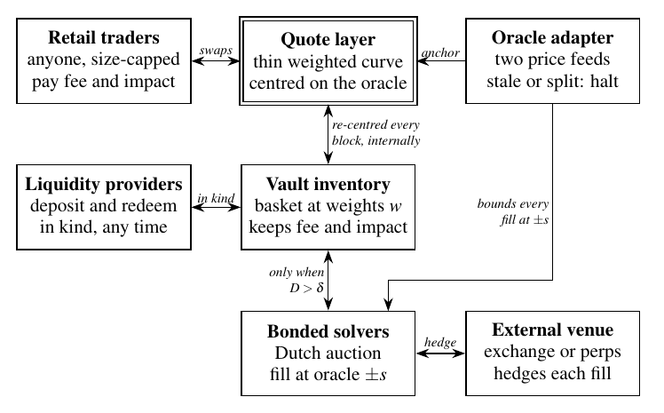
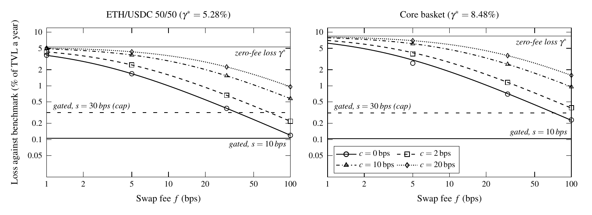
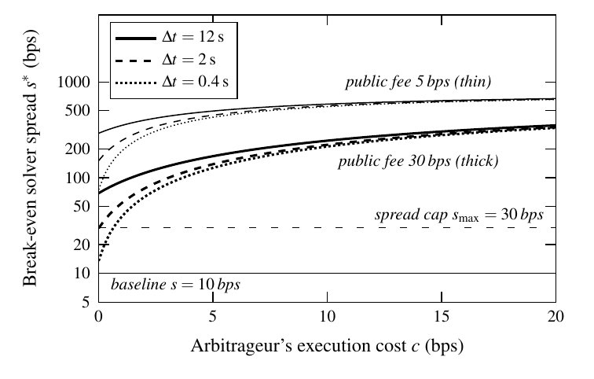

<div align="center">

# Gated Pools

### On-chain index baskets that rebalance at a band, not at the fee

**Robert Auxt** · White paper, Draft v0.3 · October 2026

[](Gated_Pools_White_Paper.pdf)
[](https://github.com/auxt/gated-pools/releases/tag/v0.3)
[](LICENSE)
[](simulations/LICENSE)

**[Read the paper (PDF, 13 pages)](Gated_Pools_White_Paper.pdf)**

</div>

---

## Abstract

An on-chain index basket held at fixed weights is usually run as a weighted (geometric-mean) pool that arbitrageurs rebalance. Such a pool is a **band rebalancer whose band is set by its swap fee $f$ plus the arbitrageurs' execution cost $c$**. Its loss against a frictionless constant-weight benchmark is

$$L_{\mathrm{pub}} \;=\; \gamma^{*}\,\frac{c+\rho}{f+c+\rho}, \qquad \rho \approx 0.583\,\sigma\sqrt{\Delta t},$$

where $\gamma^{*}$ is the basket's excess growth rate. The formula is exact to first order for two assets and within 1.4% of a block-by-block simulation across 32 parameter sets. Faster blocks cannot remove the cost term, and at 10 bps of arbitrage cost only a fee of almost 10% would make a six-token basket cheap to rebalance.

A **gated pool** removes the coupling between fee and rebalancing. Bonded solvers rebalance it only when its weights drift past a chosen band $\delta$, at oracle price plus a spread $s$ that is capped on-chain. Retail trades a separate quote anchored to the oracle. Its cost is

$$L_{\mathrm{gate}} \;=\; \frac{sK}{\delta+\delta_{\mathrm{in}}}.$$

## Headline result

Six-token crypto basket (BTC, ETH, SOL, HYPE, LINK, USDC), 30 bps fee, 12-second blocks, 10 bps execution costs:

| | Turnover (× TVL a year) | Cost of holding target weights (% of TVL a year) |
|---|---:|---:|
| Public weighted pool | 19.8 | **2.53** |
| Gated pool, 2.5% band | 1.04 | **0.10** |

The advantage survives volatility scaling, volatility regimes, trends, mean reversion and jumps; with jumps it widens to 4.10% against 0.12%. It disappears only if arbitrage is nearly free ($c < 1$ bps) on blocks of 2 seconds or less **and** solvers charge more than 14–30 bps. The largest risk found is oracle price selection on rebalancing fills; the paper specifies the timestamp rule that closes it.

## Figures

<p align="center"></p>
<p align="center"><em>Figure 1. One gated pool: quotes follow the oracle every block; inventory moves only when drift exceeds the band, through bonded solvers at oracle price ± s.</em></p>

<p align="center"></p>
<p align="center"><em>Figure 2. Loss of a public weighted pool by swap fee and arbitrage cost: theory (curves) against simulation (markers), with the gated pool for reference.</em></p>

<p align="center"></p>
<p align="center"><em>Figure 3. Break-even solver spread: the gated pool is cheaper below each curve; the on-chain cap is 30 bps.</em></p>

## What is in the paper

1. **Theory.** Closed-form costs of public and gated rebalancing, with the break-even solver spread and the public fee that would match the gated cost.
2. **Mechanism.** Vault and drift, the gate (reverse Dutch auction, on-chain invariants, bonds, permissionless fallback) and the oracle-anchored quote layer.
3. **Validation.** Simulated against predicted turnover and loss for public pools and gated vaults.
4. **Twelve assumptions challenged.** Each is tested with a stated verdict: costs, solver competition, block time, volatility, regimes, drift, jumps, oracle latency and selection, informed flow, retail volume, the basket approximation, fixed costs.
5. **Retail flow and alternatives.** Single-arbitrageur pools and a constant-product version.
6. **Appendices.** Step-by-step derivations (A), a worked example for every number in the paper (B) and simulation methods (C).

## Repository layout

| Path | Contents |
|---|---|
| [`Gated_Pools_White_Paper.pdf`](Gated_Pools_White_Paper.pdf) | The compiled paper |
| [`paper/`](paper) | LaTeX sources. Sections are `s1`–`s7`, appendices `appA`–`appC`. Figures are drawn in TikZ/pgfplots (`fig_*.tex`, data in `fig/*.dat`). |
| [`simulations/sim_v.c`](simulations/sim_v.c) | Validation and stress-test simulator: public pools, gated vaults, the quote layer and an informed latency trader |
| [`simulations/an_v.py`](simulations/an_v.py) | Analysis and closed-form predictions |
| [`simulations/mk_*.py`](simulations) | Build the tables and figure data from the runs |
| [`simulations/worked.py`](simulations/worked.py) | Numbers for the worked examples in Appendix B |
| [`simulations/v/`](simulations/v) | Job lists, runner and all result CSVs |
| [`docs/img/`](docs/img) | Figure images for this page |

## Reproducing

```bash
cd simulations
gcc -O3 -o sim_v sim_v.c -lm
cd v && ./run.sh jobs1.txt && ./run.sh jobs2.txt   # about one hour on two cores
cd .. && python3 mk_valid.py && python3 mk_gate.py && python3 mk_retail.py && python3 mk_figdata.py
cd ../paper && pdflatex main.tex && pdflatex main.tex
```

You need a C compiler, Python 3 with NumPy and SciPy, and a TeX Live installation that includes `pgfplots`.

## Citation

```bibtex
@techreport{auxt2026gatedpools,
  author      = {Auxt, Robert},
  title       = {Gated Pools: On-Chain Index Baskets That Rebalance at a Band, Not at the Fee},
  institution = {Independent},
  type        = {White paper, Draft v0.3},
  year        = {2026},
  month       = oct,
  url         = {https://github.com/auxt/gated-pools}
}
```

## Licence

The paper, its sources and figures are licensed under [CC BY 4.0](LICENSE). The simulation code in [`simulations/`](simulations) is licensed under the [MIT licence](simulations/LICENSE).

## Status and disclaimer

This is a draft for discussion. The design has not been built or audited, and the parameters are stylised rather than estimated from market data. Nothing here is financial, investment, legal or tax advice. The paper was prepared with substantial assistance from Claude (Anthropic); see the declaration in the paper.
